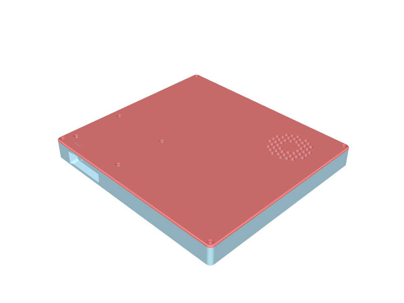
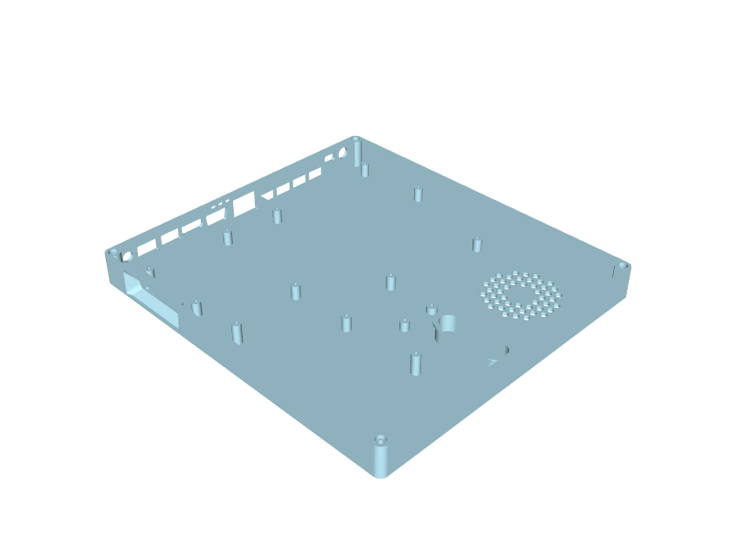
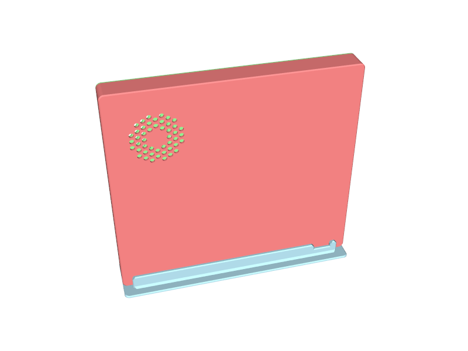
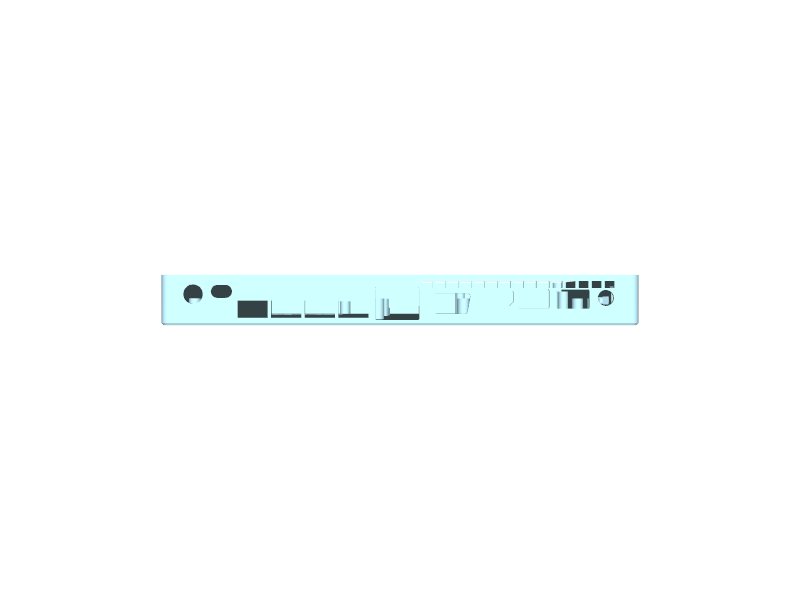
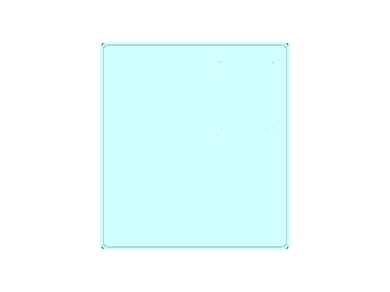
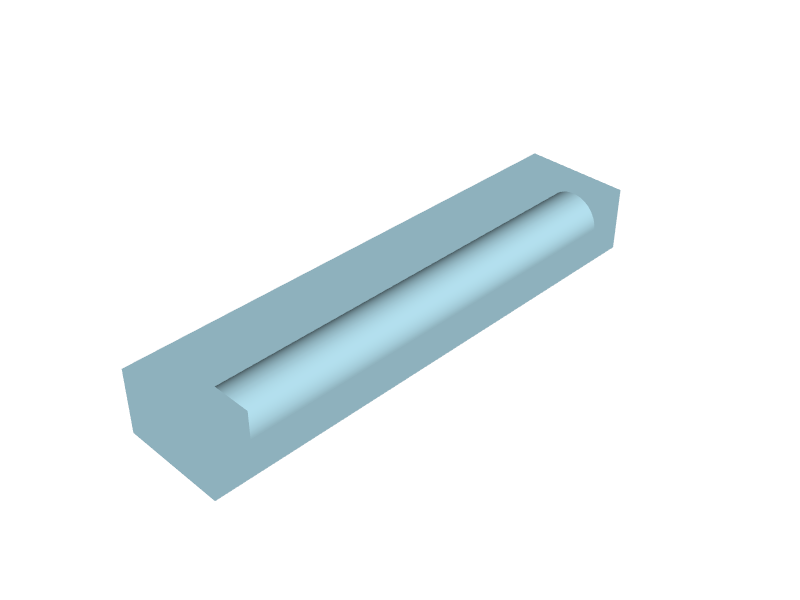
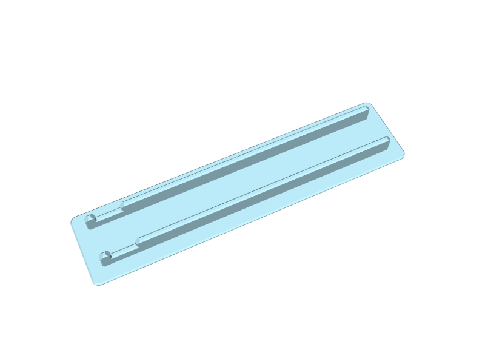

# ASUS X541U headless case

A 3D-printed PETG case for the motherboard of an ASUS X541U laptop (board code X541UVK), run headless as a small server.
The board, its fan, the WiFi card and a 2.5 inch SSD on the optical-drive daughterboard all mount in a flat base with a
screwed-on lid. The case stands upright in a separate stand with the ports to the back. Printed on a Bambu Lab P1S.







## Parts to print

All files are in `cad/out/`. Everything prints without supports.

| File | What it is | Orientation |
|---|---|---|
| `base.stl` | Base: standoffs, fan mounts, wind channel, port windows, vents, SD card funnel | As is, floor down |
| `lid.stl` | Lid with lip, screw holes, fan grille and LED peek slit | Already flipped, top face down |
| `odd_spacer.stl` | Spacer under the daughterboard's hole over the main board, with a nub up to the lid | Nub up |
| `odd_clip.stl` | Clip on the daughterboard's pointy end that keeps the ribbon cable from creasing | Flat, dome up |
| `stand.stl` | Stand for standing the case on either end, ports to the back | Slot up |
| `jig.stl`, `io_jig.stl`, `lid_jig.stl` | Test fixtures for checking hole and port positions with less filament | As the parts above |

Hardware: the laptop's own M2.5 screws for the board, fan and daughterboard, M3 heat-set inserts in the corner posts and
M3 x 10 screws for the lid.









## Regenerating the files

The whole design is one build123d script, `cad/base.py`, with all dimensions as named parameters at the top. It is run
through the [build123d-mcp](https://pypi.org/project/build123d-mcp/) server (configured in `.mcp.json`), which also
validates, renders and exports the parts. The Python tools use `uv`.

Board dimensions come from photos: the scripts in `tools/` measure holes, ports, the fan and the SSD from the images in
`photos/` and write `measurements/*.json`. Corrections from test prints are applied by `tools/apply_print_feedback.py`,
and `tools/gen_params.py` stamps the result into the parameter block at the top of `cad/base.py`.

```
uv run tools/apply_print_feedback.py
uv run tools/gen_params.py
```

## Design notes

[DESIGN.md](DESIGN.md) is the working spec: the hardware, every design decision and why, the measurement tables, the
open questions to answer after each test print, and a dated log of changes.
